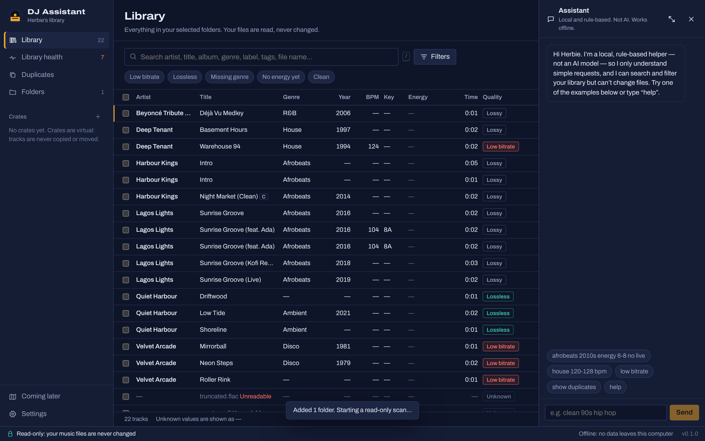

# DJ Assistant

A local-first Windows desktop app that helps a working DJ organise, search and check a music library — **without ever changing the music files or Serato's data**.

Version 0.1 is deliberately small and safe: it catalogues the folders you choose, lets you search and filter, build virtual crates, spot low-bitrate files, and review possible duplicates. Everything stays on your computer.



## What v0.1 does

| Feature | Notes |
|---|---|
| Choose music folders and external drives | Only folders you add are scanned. Nested/duplicate folders are refused so a file is never catalogued twice. |
| Read-only background scan | Bounded worker pool, progress, **pause / resume / cancel**. Unchanged files are skipped on rescan. Symlinks/junctions are not followed (no loops). |
| Persistent local catalogue | SQLite file in your app-data folder (`%APPDATA%\com.deejaykyle.djassistant\catalogue.sqlite3`), never inside your music folders. |
| Tags and technical properties | Title, artist, album, album artist, genre, date/year, original year, track/disc, composer, label, comment, ISRC, BPM and key tags, format, codec, lossless/lossy, duration, bitrate, sample rate, bit depth, channels, size. Unknown values are shown as **—**, never guessed. |
| Formats | MP3, FLAC, WAV, AIFF, M4A (AAC and ALAC), Ogg Vorbis, Opus, APE, WavPack, Musepack (via [lofty](https://crates.io/crates/lofty)). WMA, DSF/DFF and others are listed as **unsupported** in Library health rather than ignored. |
| Search and filters | Accent- and case-insensitive search across title, artist, album, genre, label, file name, tags and notes. Filters on artist, title, genre, year, decade, BPM, key, energy, rating, mood, colour, tags, version, clean/explicit, quality, bitrate, format, location and more. |
| Your own catalogue values | Energy (1–10 LED meter), rating, colour, mood, tags, notes, and overrides for genre, year, BPM, key, version and clean/explicit. Stored only in the app; **never written to files**. Original file values remain visible separately. |
| Virtual crates | Manual crates and smart (rule-based) crates with AND/OR, ranges, exclusions, manual additions and a **live preview before saving**. A track can be in many crates. Rules are data compiled with a whitelist; user text is always a bound parameter. |
| Low-bitrate warnings | Lossy files with a known average bitrate below a configurable threshold (default **128 kbps**). Lossless and unknown-bitrate files are never flagged by this rule. |
| Duplicate review | **Exact** (full-file BLAKE3 hash), **possible** (same normalised artist + title, same version label, length within 2 s) and **alternate versions** (same title, different labels such as Remix/Live/Clean) are kept separate, each with its reason. You record a decision; nothing is deleted or merged. |
| Library health | Missing title/artist/genre/year, unreadable or corrupt files, unsupported formats, low bitrate, unknown quality, offline drives, missing files, and the last scan's problems. |
| Offline drives | If a folder/drive is unavailable, it is marked **offline** and its tracks are kept. Tracks are only marked **missing** after a completed scan of an available folder — never deleted. |
| Assistant sidebar | A **rule-based helper, not an AI model**. It turns requests like “afrobeats 2010s energy 6-8 no live” into the same filters the UI uses, says what it understood, and can open views. It cannot change anything. Open by default; hide with ✕ or **Ctrl+J**, or expand to full screen. |
| Privacy / safety notice | Shown on first run and always available in Settings. |

## Safety model

- The app **only reads** music files. CI runs `scripts/check-read-only.sh`, which fails the build if any file-writing, renaming, copying or deleting API appears in the core library or desktop shell (the only exception is the app's own log file).
- It does **not** read or write Serato databases, crates, cues, beatgrids, history or settings.
- Removing a folder or deleting a crate only removes catalogue rows. Files are untouched.
- Scans write to the catalogue in short transactions. A cancelled, interrupted or crashed scan leaves the catalogue consistent; interrupted scans are labelled as such on next start.
- File changes (tag edits, renames, replacements) are **not in this version**. When added they will require a preview, conflict checks, a verified backup, your approval and a change log — see [ROADMAP.md](ROADMAP.md).

## Privacy

- No account, no telemetry, no analytics, no online services in v0.1.
- The core library (`crates/dj-core`) has no network dependencies; CI checks the dependency tree and, on Linux, traces system calls during scanning to confirm no internet sockets are opened.
- The window's Content Security Policy only allows the app's own IPC channel.
- Logs (`%LOCALAPPDATA%\com.deejaykyle.djassistant\logs\dj-assistant.log`) record command names and errors only — not your search text or arguments.
- Future online features (MusicBrainz, AcoustID, Last.fm) will be off by default, will explain exactly what they send before you enable them, and will keep credentials in Windows Credential Manager.

## Install (Windows 10/11, 64-bit)

1. Download the installer (`DJ.Assistant_0.1.0_x64-setup.exe` for v0.1.0; later releases use `DJ-Assistant_<version>_x64-setup.exe`) and `SHA256SUMS.txt` from the [Releases](../../releases) page.
2. Recommended — verify the download in PowerShell:
   ```powershell
   Get-FileHash ".\DJ.Assistant_0.1.0_x64-setup.exe" -Algorithm SHA256
   ```
   The hash must equal the one in `SHA256SUMS.txt` (for v0.1.0: `2fb1525473aecd4685504965d6edd7b0766172dbc6876034c475d408314eefb9`). In v0.1.0 the file name inside `SHA256SUMS.txt` shows a space instead of the dot GitHub added; the hash is what matters.
3. Run the installer. It installs for the current user (no admin needed).

**The installer is not code-signed.** Windows SmartScreen will probably show “Windows protected your PC”. Choose **More info → Run anyway** only if the checksum matches. The app uses Microsoft Edge WebView2, which is built into Windows 11 and current Windows 10; if it is missing the installer downloads it from Microsoft.

## Using it

1. **Folders → Choose folders…** (or type a path) — a read-only scan starts.
2. **Library** — search (press **/**), use preset chips or **Filters**, click a track for details, set energy/rating/tags, multi-select (Ctrl/Shift-click, Space, Ctrl+A) to add to crates.
3. **+ next to Crates** — create a manual or smart crate. Filters in the library can be saved as a smart crate.
4. **Duplicates → Check for exact duplicates** — compares full file contents of same-size files.
5. **Library health** — click a card to see the affected tracks.
6. **Settings** — low-bitrate threshold, theme, safety and privacy information.

## Build from source

Requirements: Rust 1.97 (pinned in `rust-toolchain.toml`), Node 22, and on Windows the MSVC build tools + WebView2.

```bash
npm ci
cargo test -p dj-core          # core tests
npm test                       # front-end unit tests
npx tauri dev                  # run the desktop app
npx tauri build                # Windows installer in target/release/bundle/nsis
```

Browser-based development and the e2e test use a **development-only** bridge (`crates/dj-devbridge`, loopback only, never shipped):

```bash
npm run e2e                    # real UI + real backend + real fixture audio files
```

Other checks: `scripts/check-no-network.sh`, `scripts/check-read-only.sh`, `python scripts/check-licenses.py`.

## Tech stack

Tauri 2 + Rust + React/TypeScript + SQLite. See [docs/ARCHITECTURE.md](docs/ARCHITECTURE.md) for why, and [docs/TESTING.md](docs/TESTING.md) for what is tested automatically and what still needs manual Windows/Serato testing.

A code knowledge graph can be generated locally with [Graphify](https://github.com/Graphify-Labs/graphify): `graphify update .` (output in `graphify-out/`, not committed).

## Current limitations

- Windows build is produced and tested in CI, but **has not yet been hand-tested on a real Windows PC with a real library or alongside Serato** (see [docs/TESTING.md](docs/TESTING.md)).
- Installer is unsigned (SmartScreen warning).
- BPM and key come **only from existing file tags**; there is no audio analysis yet.
- Bitrate is the value reported by the file (an average for VBR). It does not prove audio quality.
- “Year” is the file's date tag; the app cannot tell whether that is an original, remix or reissue year.
- Folder watching, metadata suggestions, discovery, set planning, gig mode and online services are **not implemented** — see the in-app “Coming later” page and the roadmap.
- Very large libraries (100k+ tracks) have not been benchmarked yet.

## Licence

MIT. Third-party licences: [THIRD_PARTY_LICENSES.md](THIRD_PARTY_LICENSES.md).
