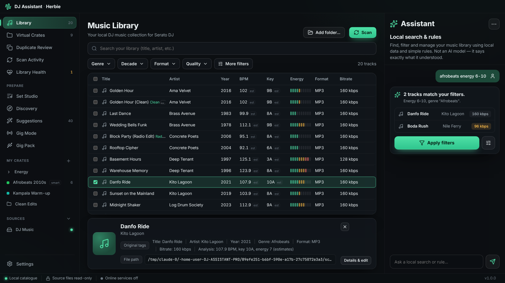

# DJ Assistant

A local-first Windows app that helps a working DJ organise, analyse, plan and prepare — **without risking the music library**. Built for Herbie, who plays out with Serato DJ.



## What it does (v1.3)

**Studio (new in 1.5, extended in 1.6)** — under *Create* in the sidebar:
- **Stems:** vocals, drums, bass and melodies from any track, with key, tempo, live chords, WAV stems and a MIDI file.
- **Remix:** tracks and stems on a beat grid; move, trim, loop, duplicate and delete clips, with undo and redo; every clip is auto-synced to the remix's tempo and key.
- **DJ Decks:** two decks with Sync, key matching, live stem toggles, 3-band EQ, a filter, hot cues, beat loops and a crossfader.
- **Synth Lab** and **Drum Lab:** describe a sound or a kit in words, play it from the keyboard or a MIDI controller, and save it as WAV plus SFZ. Drum Lab also has a 16-step sequencer with swing that exports loops as WAV or MIDI.

It all runs on this computer. Stems use signal processing rather than an AI model, so they're private but less clean than AI separators.

**Quick Prep (new in 1.3)** — a fast lane for a folder of fresh downloads. Pick a folder (it's added read-only and analysed on this computer, with a small mini-game while you wait), then one of four paths:
- **Clean names:** strips `[FREE DL]`, `www.site.net`, `320kbps`, `final FINAL v3`, track numbers and underscores; fixes capitals; keeps the mix name; *Artist – Title* or *Title – Artist*; edit any name inline; genre per track. Saved to the catalogue only.
- **Build a playlist:** drag to reorder or one-click *Warm-up → peak* (harmonic, smooth tempo steps), *Ascending BPM*, *Harmonic*, *Group by genre*, *Cool down*, or type what you want ("fastest first"). A flow score shows how well it mixes.
- **Organise folders:** set up gig folders with *Warm Up / Groove / Peak Time* sub-folders, listen on the waveform, and press **1–9** to sort each track (or drag it). *Auto-sort by energy* does it for you.
- **Split by genre:** groups by genre, or by families (Tech House + Deep House → House).

Every path exports as a **verified copy in a new folder**, **one ZIP**, or **playlists only** (pointing at your originals), with an `.m3u8` per folder and — optionally — clean title, artist, genre, BPM and key written into the **copies** (MP3, FLAC, M4A; never the originals). Folders and genres can also be saved as crates.

**Local accounts (new in 1.3)** — no sign-in. Create one account or several (a second DJ, a separate library) from the title bar; each keeps its own folders, crates, sets, analysis and settings in its own catalogue on this computer. An existing catalogue becomes the first account automatically.

**Library** — choose music folders and drives; read-only background scanning with pause/resume/cancel; tags and technical properties for MP3, FLAC, WAV, AIFF, M4A (AAC/ALAC), Ogg, Opus and more; fast accent-insensitive search; Genre / Decade / Format / Quality filters plus a full rule builder; offline drives kept, never treated as deleted; folder watcher that notices new music.

**Video files** — music videos and visuals (MP4, M4V, MOV, MKV, WebM, AVI) are catalogued next to your audio with resolution, codec and frame rate, so you can search, rate, tag and crate them. Only file headers are read and videos are never written to. Media and resolution filters, a Video badge, and an option to turn video scanning off.

**Auto-prep** — after every scan, new tracks are analysed and recommended fixes (titles, artists, genres, years…) are applied to your catalogue; empty fields are filled from evidence, existing values change only at high confidence. Undo from Suggestions.

**Organise Files (opt-in)** — write catalogue fixes into file tags, rename files by template, sort files into folders, rename folders, remove corrupt/empty files to a restorable area, and replace duplicates. Every change is previewed, approved, change-checked and undoable.

**Export crates** — to Serato (.crate files, never overwriting), rekordbox (XML) or folders (verified copies with playlists).

**Look & sound** — colour themes or a custom accent, background styles, page transitions, animation speed, completion sounds, animated splash, system tray icon.

**Your catalogue** — energy (1–10 LED meter), star ratings, colour, mood, tags, notes and overrides for title, artist, genre, year, BPM, key and more. Stored in DJ Assistant only; the file’s own tags stay visible separately.

**Virtual crates** — manual and smart crates (AND/OR, ranges, exclusions, manual additions, live preview), nested folders, and one-click templates from the *Crate & Playlist Cheat Sheet*: genres, energy (Peak Time 9–10 → Cool Down 1–2), utility (openers, closers, bangers, acapellas…), events, ratings (Guaranteed → Archive), decades and genre-by-energy folders. Crate-hygiene warnings for vague or oversized crates. Export any crate or selection as M3U8 or CSV.

**Audio analysis (local)** — BPM with half/double-time alternatives, key with Camelot code, energy (scaled to your library), loudness (LUFS), peak, clipping, silence, intro/outro length, cue ideas (first sound, mix-in, drop, mix-out), waveform, tempo-drift warning and an audio fingerprint. All shown as estimates with method and version; your values always win.

**Suggestions** — from file names, folder names, consistent spellings, analysis, and (opt-in) MusicBrainz, AcoustID, the free Deezer & Apple Music catalogues, Spotify, YouTube & YouTube Music and GetSongBPM (BPM and key checked against the audio analysis; release year, genre, album, label and artist credits — applied automatically only when the sources or the audio agree). Each shows the current value, the suggestion, source, evidence and confidence. Accept, edit or reject; accepting writes to the catalogue only. Original release year is kept separate from file/remix/reissue years.

**Duplicates & health** — exact (full-file hash) vs possible vs alternate versions, with reasons and review notes; library health for missing metadata (with a **Fix** list that offers evidence-based suggestions and bulk editing, saved to the catalogue only), unreadable/unsupported files, low bitrate (configurable, default 128 kbps, never applied to lossless or unknown), offline drives and missing files.

**Discovery** — tracks that fit a crate (with reasons), gaps, alternatives to overplayed tracks, version-aware tracklist matching (owned / possibly owned / missing / unknown), Last.fm similar artists and tracks (opt-in), new releases from artists you follow (MusicBrainz, opt-in), store search links (Beatport, Bandcamp, Traxsource, Juno, Apple, Amazon, YouTube preview). “What I’ve learned” can be inspected, switched off and reset.

**Set Studio** — event, audience, length, genres, must-plays, exclusions, clean-only, BPM range, energy journey (journey, warm-up, peak, wedding, lounge) → an editable running order with tempo/key transition notes, alternatives per slot, reordering, emergency floor-fillers; save, export M3U8, save as crate.

**Gig Mode & Gig Pack** — offline set list, request queue, DJ notes and play log with background work paused; post-gig recap. Gig packs copy a crate or set to a USB drive into a new folder, verify every copy by hash, and write a manifest, playlist and missing-file report.

**Serato & history** — read-only import of Serato crates and Serato history CSV exports.

**Safe tag writing (opt-in, off by default; also used by Organise Files)** — write catalogue values to MP3/FLAC/M4A tags with an exact preview, change detection, a verified backup, checks that the audio data and every other tag frame (including Serato’s cue/beatgrid frames) are preserved, a change log and exact-byte rollback.

**Personal files (opt-in module)** — index chosen document folders, search names and text (txt, md, csv, json, docx, odt…), flag duplicates and encrypted/unreadable files, suggest organisation. Never used for music recommendations.

**Assistant** — an AI assistant that already knows every feature of the app (choose from a dropdown: free online AIs such as Gemini, Groq, OpenRouter's free models and GitHub Models; Claude, ChatGPT, DeepSeek or Grok with your own key; any OpenAI-compatible server; or any model in Ollama on this computer; off by default). It looks things up in your library, filters views, and proposes actions (crates, energy/genre/key edits, tags, templates, scans, analysis, sets, gig mode, settings) as cards that run only when you press Run. It can never change music files or Serato data. Without AI, the built-in rule-based assistant and **/commands** (/scan, /fix genre, /set 120 wedding, /keys musical…) still work. Hide it with Ctrl+J.
**Quick Prep AI help** — when the AI assistant is on (below), *Improve with AI* sharpens clean names and genres and the playlist box understands any request. It uses the same model you chose for the assistant and sends only file names, tag text and BPM/key/energy — never audio or file paths. Answers are suggestions; your edits win.

**Assistant** — a local, rule-based helper (not an AI model) in a sidebar you can hide (Ctrl+J) or expand. “afrobeats 2010s energy 6-8 no live”, “low bitrate”, “plan a 2 hour wedding set”, “gig pack”… It says exactly what it understood and can only search, filter and open views.

**Key notation** — show keys as Camelot (8A) or musical names (Am); search, filters and the Assistant accept either, including Open Key (1m).

**Premium UI** — a title-bar switch for the Midnight Pro look from RxPOS, with a translucent sidebar, a glowing current page, glass cards, mono figures and light beams. It only repaints.

**Auto-update** — signed updates install in place from GitHub releases (see [docs/UPDATES.md](docs/UPDATES.md)). Can be turned off in Settings.

## Safety

- Music files are only read, except by the opt-in tag writer (above). Quick Prep writes tags only into new copies it has just made and verified. CI fails the build if any other module gains a file-writing API (`scripts/check-read-only.sh`).
- Serato’s databases, crates, cues, beatgrids, history and settings are never written.
- Nothing is ever deleted or merged; duplicate decisions are notes.
- Scans and analysis commit in short transactions; cancelled or crashed runs leave the catalogue consistent.

## Privacy

- No online account and no telemetry; accounts are local to this computer. The core library has no network code; CI traces system calls during scanning, analysis, Set Studio, gig packs, tag writing and personal-file indexing to prove no internet sockets are opened.
- Online services (MusicBrainz, Deezer & Apple Music catalogues, Spotify, YouTube & YouTube Music, GetSongBPM, AcoustID, Last.fm, the AI assistant, update checks) live in a separate crate, are **off by default** (except update checks, which you can turn off), and each explains exactly what it sends. AcoustID asks before every batch. API keys go to Windows Credential Manager and are never shown, logged or stored in the catalogue.
- Logs record command names and errors only.

## Install (Windows 10/11, 64-bit)

1. Download `DJ-Assistant_<version>_x64-setup.exe` and `SHA256SUMS.txt` from Releases.
2. Verify: `Get-FileHash .\DJ-Assistant_1.0.0_x64-setup.exe -Algorithm SHA256` and compare with `SHA256SUMS.txt`.
3. Run it (per-user install, no admin needed). The installer is **not code-signed**, so SmartScreen will warn — choose *More info → Run anyway* if the checksum matches.
4. Later versions arrive through **Settings → Updates** (or the banner on start-up); no need to download again.

## Build from source

Rust 1.97 (`rust-toolchain.toml`), Node 22, and on Windows the MSVC build tools + WebView2.

```bash
npm ci
cargo test -p dj-core -p dj-online
npm test
npm run e2e          # real UI + real backend + real audio fixtures (dev-only loopback bridge)
npx tauri dev
npx tauri build --config src-tauri/tauri.ci.conf.json   # installer without updater signing
```

Other checks: `scripts/check-no-network.sh`, `scripts/check-read-only.sh`, `python scripts/check-licenses.py`. `scripts/make-demo-library.sh <dir>` generates a 20-track synthetic demo library for trying the app.

See [docs/ARCHITECTURE.md](docs/ARCHITECTURE.md), [docs/TESTING.md](docs/TESTING.md), [ROADMAP.md](ROADMAP.md) and [docs/UPDATES.md](docs/UPDATES.md).

## Known limitations

- **Not yet hand-tested on a real Windows PC, a real library or alongside Serato** — automated tests run on Windows CI. Please work through the manual checklist in docs/TESTING.md, starting with copies of your music.
- Installer unsigned (SmartScreen warning).
- Video: WMV, FLV, MPEG, MTS/M2TS, 3GP and VOB are listed as unsupported. Opus audio (common in WebM) and AVI audio can't be analysed yet. Videos are never written to.
- Analysis is estimation: half/double tempo and relative/modal key confusion happen; energy is relative to your own library.
- Online services and the AI assistant were verified with recorded responses, a scripted model and a fake local model server in tests. Live calls to Anthropic, MusicBrainz, AcoustID, Last.fm or a real Ollama install could not be made from the build environment.
- Stem separation is not included. Physical file moves/renames are deliberately not offered (they break Serato links).
- Serato crate parsing follows the community-documented format; it is read-only and may need updates if Serato changes it.

## Licence

MIT. Third-party licences: [THIRD_PARTY_LICENSES.md](THIRD_PARTY_LICENSES.md) (includes Symphonia under MPL-2.0; its source is published on crates.io).
